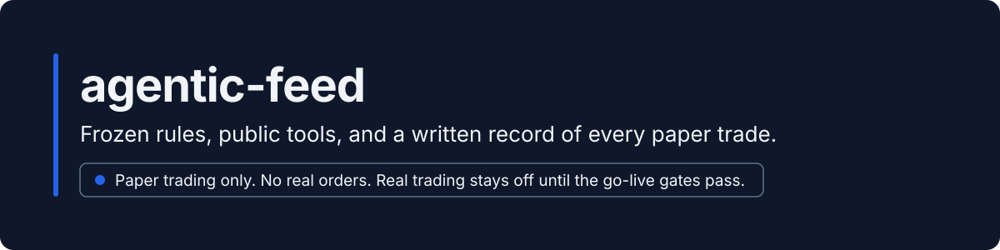
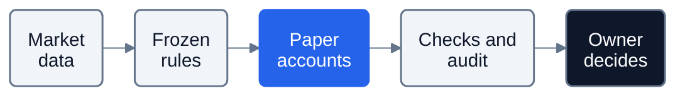
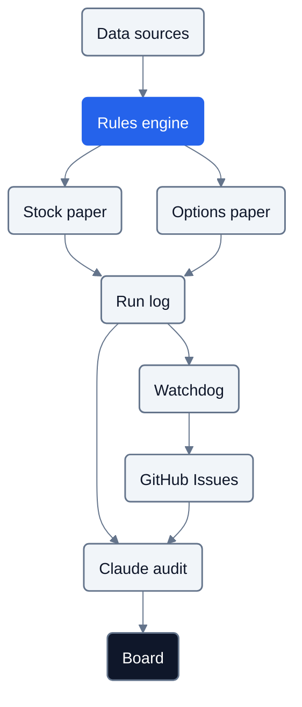
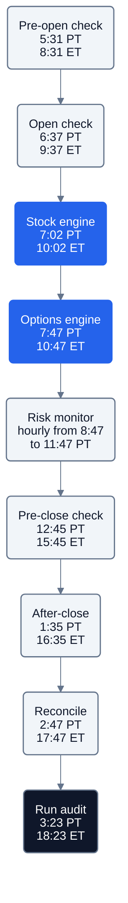
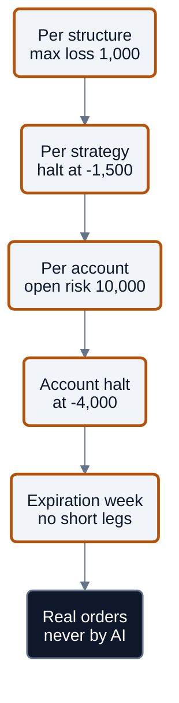
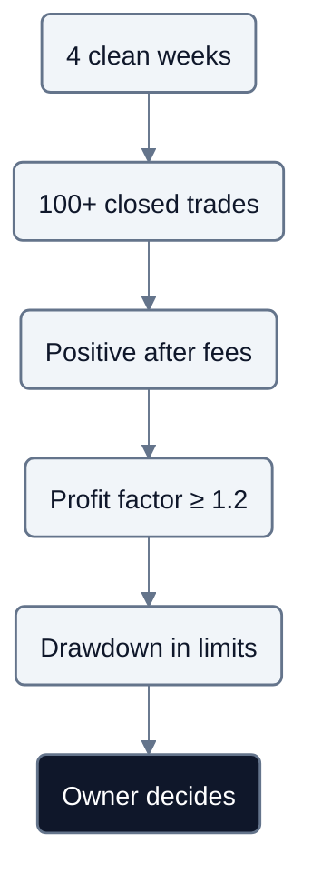
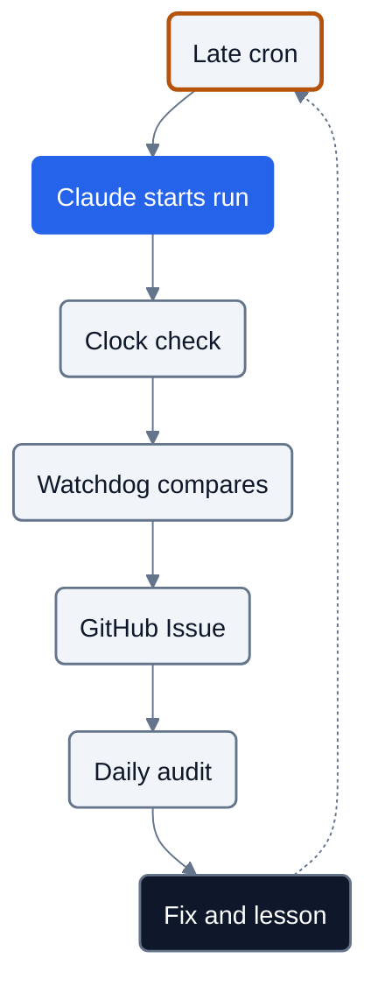

<p align="center"></p>

The public window into Agentic Lab: a small research system that tests trading rules on paper accounts, under limits written down before any trade, with every result kept on record. This repository publishes the market-data feed and this overview. The engine, the strategies and their rules run from a private repository (since 2026-11-22).

**Paper trading only. No real orders. Real trading stays off until the go-live gates pass.**

[](https://github.com/jaffershashimi/agentic-feed/actions/workflows/ci.yml)
[](https://github.com/jaffershashimi/agentic-feed/actions/workflows/publish.yml)

## System at a glance



<sub>Static copy: [docs/diagrams/glance.svg](docs/diagrams/glance.svg)</sub>

## What this is, and what it is not

| This is | This is not |
|---|---|
| A paper-trading research system with rules frozen before testing | A fund, a signal service or investment advice |
| Public, pinned tools anyone can re-run and match byte for byte | A claim that any strategy makes money (none has shown an edge yet) |
| A written record of every result, including the failures | A system where an AI can place a real order |

## Architecture

Market data feeds a rules engine. The engine sends orders only to Alpaca **paper** accounts. Every job writes a run log; a watchdog compares the day's expected jobs with that log and opens a GitHub Issue for anything missing or failed. A daily Claude audit reads the log and the Issues and posts one plain report to the owner's Board.



<sub>Static copy: [docs/diagrams/architecture.svg](docs/diagrams/architecture.svg)</sub>

## Daily timeline

Times in Pacific with Eastern beside them. Every job checks the New York clock and the market calendar in its own code, so daylight-time changes and early closes do not move it.



<sub>Static copy: [docs/diagrams/timeline.svg](docs/diagrams/timeline.svg)</sub>

| Job | PT | ET |
|---|---|---|
| Options pre-open check (a failure keeps the day dry) | 5:31 | 8:31 |
| Options open check (quotes live, spreads sane) | 6:37 | 9:37 |
| Stock engine start | 7:02 | 10:02 |
| Options engine (backups 8:07 and 8:27 PT) | 7:47 | 10:47 |
| Watchdog, morning | 8:01 | 11:01 |
| Risk monitor, hourly (report only unless a frozen exit or halt fires) | 8:47 to 11:47 | 11:47 to 14:47 |
| Pre-close check | 12:45 | 15:45 |
| Watchdog, afternoon | 1:17 | 16:17 |
| Stock after-close | 1:35 | 16:35 |
| Options reconcile | 2:47 | 17:47 |
| Run audit (Board entry) | 3:23 | 18:23 |

## Risk guardrails

Layers from the smallest unit up. These are the options program's frozen limits for the 25,000 USD paper account, as written in the private engine code. A frozen limit changes only by the owner's written decision.



<sub>Static copy: [docs/diagrams/guardrails.svg](docs/diagrams/guardrails.svg)</sub>

## Go-live gates

All five must pass on paper before real trading is even discussed. Then the owner decides, and only the owner can place a real order. No AI places, previews or approves a real order.



<sub>Static copy: [docs/diagrams/golive.svg](docs/diagrams/golive.svg)</sub>

## Failure monitoring loop

GitHub's scheduled jobs on this account start late or are dropped, so time-critical runs are started directly and each job checks its own time window in code before acting.



<sub>Static copy: [docs/diagrams/failure-loop.svg](docs/diagrams/failure-loop.svg)</sub>

## Current status (paper, as of the 2026-11-20 close)

Sources: the Nov 22 paper review of the old Claude paper desk ledger, and the 2026-11-21 weekly report from the stock paper account's decision journal. Counts after fees. Paper results, never pooled, never money.

| Lane | Since (sessions) | Closed trades | Result after fees |
|---|---|---|---|
| Old Claude paper desk, two arms kept separate | Nov 2 (15) | 34 | Net -357 USD, profit factor 0.07 |
| Frozen-rule replay R2, same sessions | Nov 2 (15) | 94 | Mean -3.90 USD a trade, 95% interval -6.24 to -1.48 |
| Stock paper account, S-042 | Nov 17 (4) | 9 | Mean -9.12% a trade, all 9 stopped out |
| Stock paper account, S-048 B55M | Nov 19 (2) | 0 | Nothing closed yet |
| Options paper, OPT-PAPER-1 | Nov 23 (0) | 0 | Starts Monday |

Go-live gates met: 1 of 5 (drawdown only).

**Plain reading: no edge so far.** The replay interval sits below zero before and after costs, and none of the nine S-042 paper trades has won. Nine trades prove nothing either way. The old desk's rules stay frozen to 2026-12-18, when a pre-registered stop line decides whether its entry rules are retired.

## Repository map

| Path | What it holds |
|---|---|
| [`feed/`](feed/) | The public market-data feed (`desk-feed.json`, `health.json`) |
| [`feed_pipeline/`](feed_pipeline/) | Feed builder, market calendar, option math, risk simulation, paper lab |
| [`scripts/`](scripts/) | Privacy check |
| [`third_party/`](third_party/) | A vendored MIT skill pack, unedited, at a pinned commit |
| [`tests/`](tests/) | Unit tests (standard library only) |
| [`docs/`](docs/) | Method notes; [`docs/diagrams/`](docs/diagrams/) holds the diagrams on this page |
| [`system/`](system/) | Operating state and rule texts |

## How to verify this yourself

Python 3.12 or newer, standard library only.

```bash
git clone https://github.com/jaffershashimi/agentic-feed.git && cd agentic-feed
```

```bash
python3 -m unittest discover -s tests -t .
```

```bash
python3 scripts/privacy_check.py
```

```bash
python3 -m feed_pipeline.build --out /tmp/feed && cat /tmp/feed/health.json
```

## Honest limits

- Small samples prove nothing. 34 old-desk trades and 9 S-042 trades only show that nothing has worked yet.
- Paper fills are not real fills. Paper accounts can be kinder than a real market on price and size.
- Paper, replay and backtest results are never pooled; each is reported on its own.
- The feed's `regime` and `macro` labels are simple heuristics, not validated signals.
- Nothing here is investment advice, and nothing here claims a profit.

## What this repository never contains

Account balances, positions, orders, fills, broker identifiers, personal records, keys or secrets. `scripts/privacy_check.py` enforces a pattern guard in CI and before every publish. Keys live only in GitHub Actions secrets. No license file has been chosen yet.

<details>
<summary>Feed details and raw URLs</summary>

- `feed/desk-feed.json`: compact machine-readable feed (schema `agentic-feed/1`, at most 6,000 bytes).
- `feed/desk-feed.md`: the same content for people.
- `feed/health.json`: per-source status, `as_of` dates and errors.

Raw URLs:

- https://raw.githubusercontent.com/jaffershashimi/agentic-feed/main/feed/desk-feed.json
- https://raw.githubusercontent.com/jaffershashimi/agentic-feed/main/feed/health.json

Values carry their source and date. Missing data is `null` and listed in `data_health`, never guessed. How Agentic Lab runs today: [system/OPERATING_STATE.md](system/OPERATING_STATE.md). Rule texts are kept privately.

</details>

<details>
<summary>All method docs</summary>

- `docs/FEED_SCHEMA.md`
- `docs/DESK_CONSUMER.md` (how a consumer must read the feed)
- `docs/DATA_SOURCES.md`
- `docs/ADDING_A_SOURCE.md`
- `docs/FRED_V2.md` (bounded FRED release context)
- `docs/OPTION_MATH.md`, `docs/RISK_SIM.md`, `docs/PAPER_LAB.md`, `docs/RESEARCH_RUNNER.md` (the feed's model and simulation outputs)
- `docs/DESK_PROPOSAL.md`, `docs/PAID_DATA_DECISION.md`

The engine and strategy docs moved to the private repository with the code on 2026-11-22.

</details>
